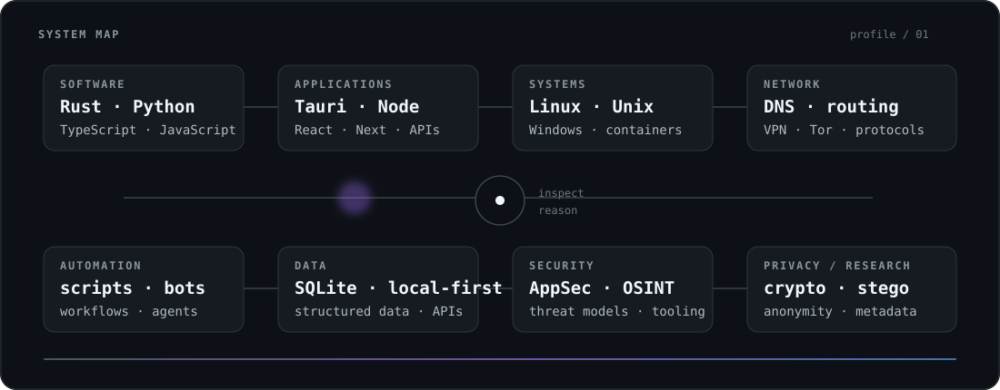
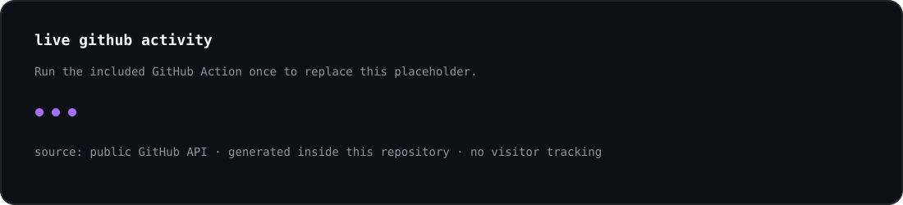

<div align="center">

# Voldigoade

**software · systems · networking · security · privacy**

I build software, inspect systems, and spend most of my time somewhere between the application layer and what sits underneath it.

</div>

<br>

<p align="center">
  
</p>

## About

Generalist developer focused on software, systems and the infrastructure around them.

I work with **Rust, Python and TypeScript/JavaScript**, build web and desktop applications, automate repetitive work, and keep going down the stack into operating systems, networking, protocols, privacy and security.

I prefer understanding a system well enough to reason about it instead of treating it as a black box.

## Live profile data

<p align="center">
  
</p>

The panel above is generated from my **public GitHub data** by a small workflow in this repository. No visitor counter, no fake terminal output, no third-party analytics.

## Working set

| Layer | Things I use / explore |
| --- | --- |
| **Languages** | Rust · Python · TypeScript · JavaScript · SQL |
| **Applications** | React · Next.js · Node.js · Tauri · APIs |
| **Systems** | Linux · Unix · Windows · containers · filesystems · virtualization |
| **Networking** | DNS · routing · VPNs · Tor · protocols |
| **Security** | AppSec · OSINT · threat modeling · privacy engineering |
| **Research** | cryptography · steganography · anonymity systems · local-first software |
| **Automation** | scripts · bots · APIs · workflows · agentic tooling |

## Current directions

- system internals and operating environments
- privacy-preserving and local-first software
- networking and protocol behavior
- security tooling and human-in-the-loop automation
- desktop tooling with Rust / Tauri
- web architecture and APIs
- cryptography, steganography and anonymity technologies

## Selected work

This section is intentionally small. I would rather keep a few projects worth opening than fill the profile with placeholders.

<!-- Add real public projects here once you want them featured. -->

## Principles

```text
understand the system
reduce unnecessary complexity
measure before assuming
keep data collection minimal
prefer reversible choices
automate the boring parts
```

<details>
<summary><strong>More</strong></summary>

<br>

I spend a lot of time testing and comparing operating systems, Linux and Unix environments, desktop stacks, networking tools, privacy technologies and different development approaches.

The subjects change; the pattern usually doesn't: build something, inspect what happens underneath, identify the trade-offs, then improve it.

</details>

<br>

<div align="center">
<sub>build · inspect · understand · improve</sub>
</div>
