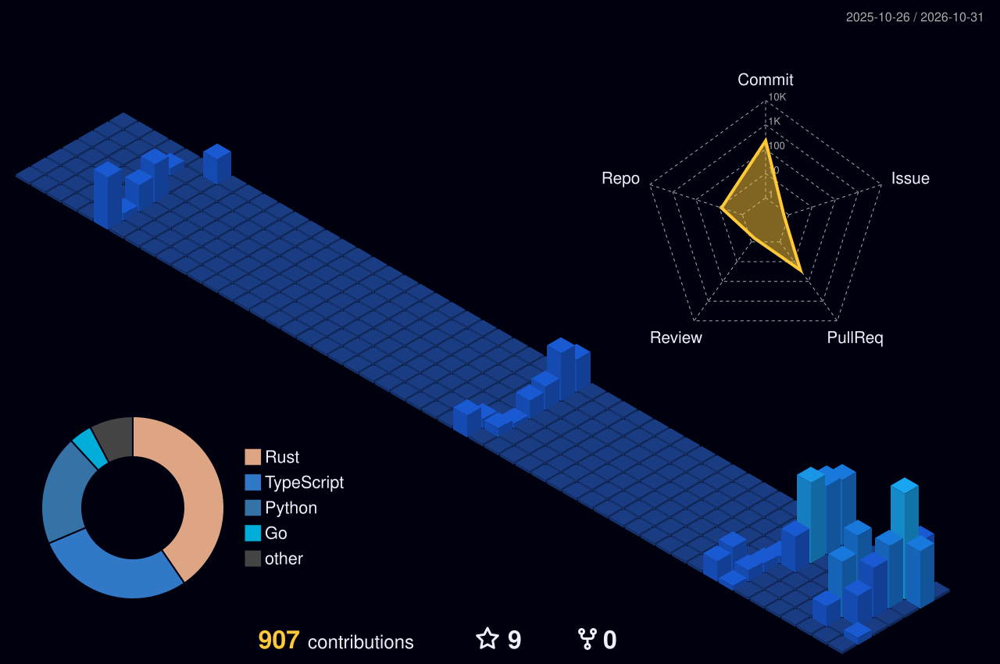

  

<h1 align="center">Voldigoade</h1>

  <samp>software · systems · security · privacy</samp>

---

I tend to bounce between layers.

A web app turns into a systemd service, that turns into a packet capture, and somehow there's a Rust tool involved by the end of the night. That's usually how it goes.

I mostly write **Rust, Python and TypeScript**. Everything else depends on what needs fixing.

Linux/Unix, networking, security, privacy, automation, LLMs if it gives me a good excuse to open too many terminals, I'm probably interested.

I don't keep much public. What's here is the stuff I actually felt like shipping.

### usually somewhere around

- systems, networking and protocols
- security, privacy and anonymity tech
- local-first and desktop software
- automation, agents and tooling
- cryptography, steganography and the weird corners of computing

### activity

  

---

  most problems get more interesting one layer down.

