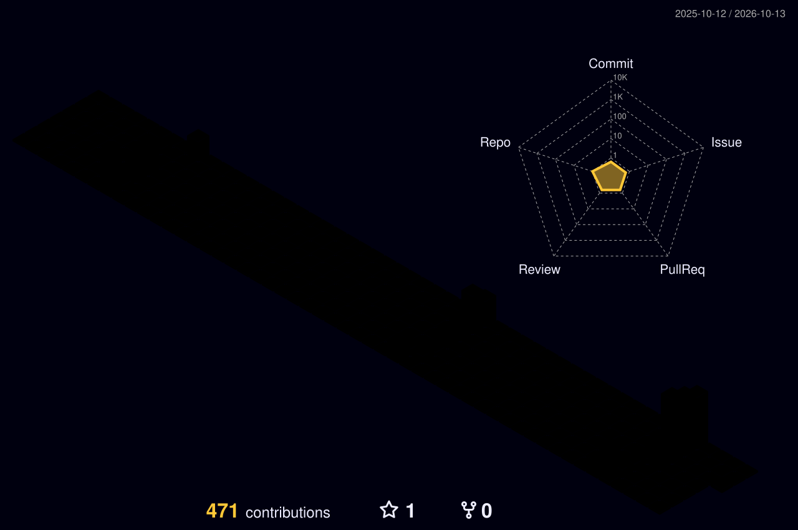

<p align="center">
  
</p>

<h1 align="center">Voldigoade</h1>

<p align="center">
  <code>software</code> ·
  <code>systems</code> ·
  <code>networking</code> ·
  <code>security</code> ·
  <code>privacy</code>
</p>

<p align="center">
  
</p>

---

I build software and spend a lot of time below the application layer: operating systems, networking, protocols, automation, privacy and security.

```text
software      Rust · Python · TypeScript · JavaScript
applications  Tauri · Node.js · React · Next.js · APIs
systems       Linux · Unix · Windows · containers · filesystems
networking    TCP/IP · DNS · routing · VPNs · Tor
security      AppSec · OSINT · threat modeling · tooling
privacy       anonymity · metadata · cryptography · steganography
data          SQLite · local-first systems · structured data
```

### Focus

- systems and operating environments
- networking and protocol behavior
- privacy-preserving and local-first software
- automation and developer tooling
- application security and OSINT
- cryptography, steganography and anonymity technologies
- web and desktop application architecture

### Activity

<p align="center">
  
</p>

### Approach

```text
understand the system
reduce unnecessary complexity
measure before assuming
keep data collection minimal
automate the boring parts
```

<p align="center">
  <sub>build · inspect · understand · improve</sub>
</p>
